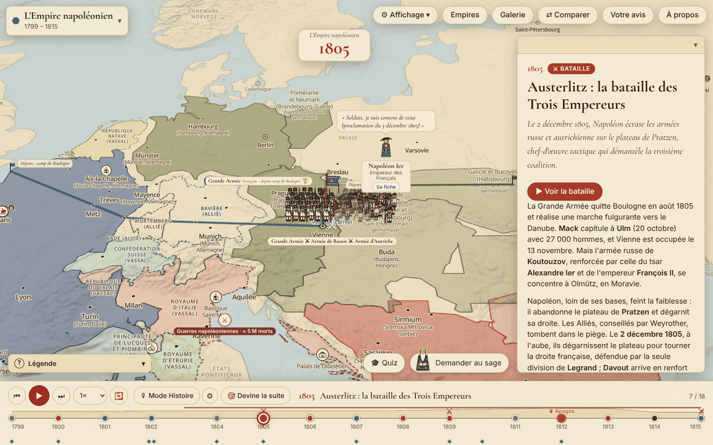
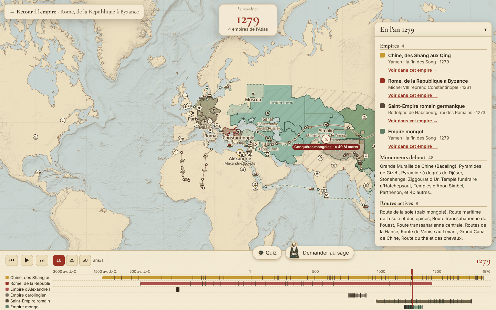
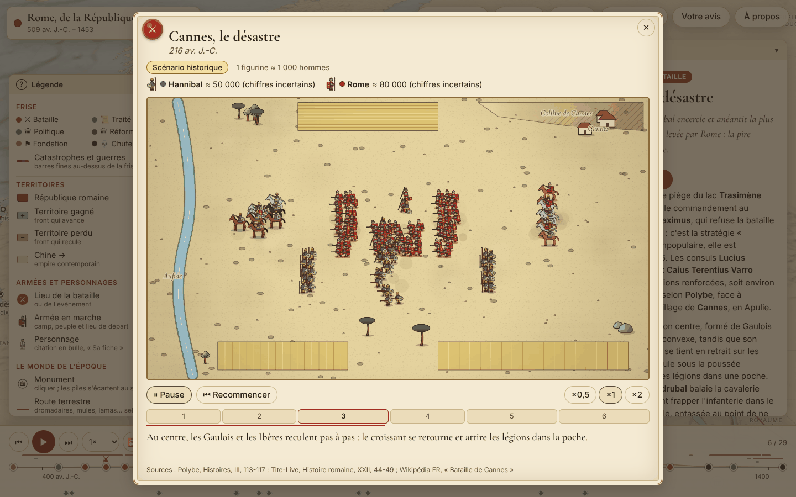
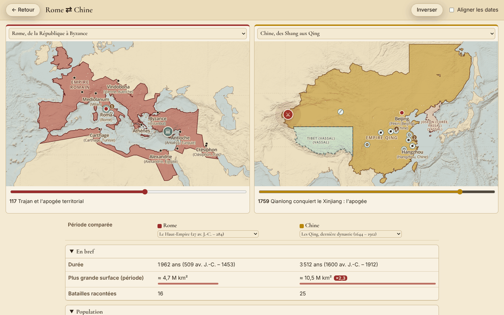
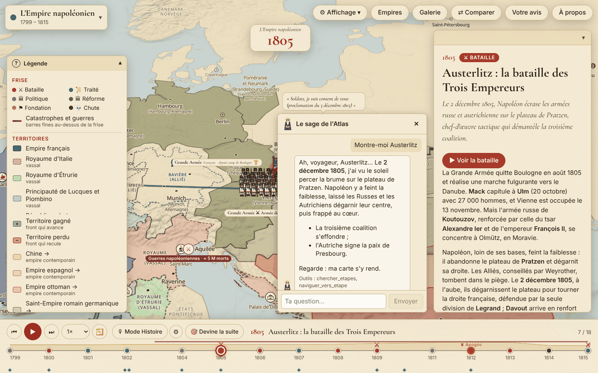
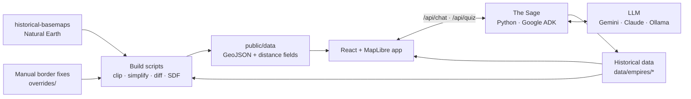

<div align="center">

# Atlas des Empires

**An interactive atlas that brings history's great empires to life: borders that glide year by year, marching armies, playable battles and an AI historian you can talk to.**

[](https://florentgru.github.io/empires-map/)
[](https://github.com/FlorentGru/empires-map/actions/workflows/ci.yml)
[](https://github.com/FlorentGru/empires-map/actions/workflows/pages.yml)
[](LICENSE)


**[▶ Open the live atlas](https://florentgru.github.io/empires-map/)**



</div>

> The interface and the historical content are in **French**.

## At a glance

| 11 empires on every continent | 305 key moments | 29 playable battles | 154 historical figures | 325 cities |
|:-:|:-:|:-:|:-:|:-:|
| from Alexander the Great to the Incas | battles, treaties, reforms, falls | 21 with a historical battle plan | biographies and quotes | with their period and modern names |

**Empires:** Alexander the Great · Rome (509 BC – 1453) · China (1600 BC – 1912) · the Mongol Empire · the Carolingians · the Holy Roman Empire · the Spanish Empire · the Ottoman Empire · the Inca Empire (1438 – 1533) · the Mali Empire (1235 – 1670) · Napoleon's Empire.

## Features

**A living map**
- Borders **glide continuously** from one date to the next, with gained land in green and lost land in red, on a tilted 3D relief map (or a flat 2D view).
- Armies march from their home city to the battlefield; historical figures appear with their famous quotes.
- Hoverable regions (vassal kingdoms, provinces, rival dynasties), neighbors of the period, contemporary empires and their capitals.
- Period layers: 87 monuments (including the Seven Wonders of the Ancient World), 92 inventions, 24 trade routes, 48 epidemics, disasters and wars.

**Storytelling**
- A clickable timeline with autoplay (×0.5 to ×2) and keyboard shortcuts.
- Each moment comes with a narrative, its consequences, a battle card and sources.
- **Story mode**: a narrator tells the empire's history step by step.
- **Guess what happens next**: a multiple-choice question before each step, with a score.

**Battles**
- **"Watch the battle"**: an animated canvas replays the battle with each army's colors and troops, at scale (1 figure ≈ N men).
- Historical formations (phalanx, testudo, tercio, square…), cavalry, elephants, artillery and musket fire, terrain and weather. Naval battles too (Actium, the Armada, Trafalgar…).

**Explore and compare**
- **The world in year X**: every empire of the atlas at the same date.
- **Compare two empires** side by side: maps, population, economy, army, culture.
- Galleries of historical figures, monuments, inventions and battle units.
- Readable, shareable URLs (`/rome/zama-202/`), mobile layout with a bottom sheet.

**An AI historian: the Sage**
- Ask questions in natural language: the Sage answers **only from the project's data**, and can move the map ("Show me Austerlitz").
- AI-written quizzes, with an offline fallback generated in the browser.

## Gallery

| | |
|:-:|:-:|
|  |  |
| **The world in year X**: 1279, every empire at once | **Watch the battle**: Cannae, 216 BC |
|  |  |
| **Compare two empires**: Rome and China at their peak | **The Sage**: an AI agent that answers and drives the map |

## Tech stack

| Layer | Technologies |
|---|---|
| Front end | React 19, TypeScript (strict), Vite 8 |
| Map rendering | MapLibre GL JS 6 (WebGL), 3D terrain, custom WebGL layer and GLSL shader |
| Geo pipeline | Node + TypeScript scripts, Turf.js, signed distance fields baked into PNGs |
| AI agent | Python, Google ADK, FastAPI; Gemini, Claude (via LiteLLM) or a local Ollama model |
| Quality | Vitest, Playwright, oxlint, Prettier, pytest, GitHub Actions |
| Hosting | GitHub Pages (static build, deployed on every push to `main`), 321 prerendered pages |

## How it works



Some engineering choices worth a look:

- **Gliding borders with distance fields.** For each transition, a build script rasterizes the old and new borders into a signed distance field (SDF) and computes when each pixel is reached. In the browser, a fragment shader only receives one number per frame, the progress `p`, so the front advances pixel by pixel at 60 fps. The shader runs as a **MapLibre custom layer** draped onto the 3D terrain.
- **Heavy geometry at build time, never in the browser.** Clipping, simplification, diffs and SDFs are precomputed. Empires are discovered from their data folder: adding one needs no code change.
- **Performance budget.** Empires, sprites and the battle engine are loaded on demand; the initial JavaScript is checked in CI to stay under **460 KB gzipped**. Animations never touch React state or rebuild map data per frame.
- **Static first, SEO included.** The build prerenders 321 HTML pages (empires, steps, galleries) with Open Graph, JSON-LD, a sitemap and `llms.txt`, so the atlas is readable without JavaScript.

Full write-up (in French): [docs/ARCHITECTURE.md](docs/ARCHITECTURE.md).

## The Sage: an AI agent built with Google ADK

The Sage is a conversational agent written in Python with [Google ADK](https://google.github.io/adk-docs/). It is designed so that the model **never answers from memory**:

- **10 tools** read the project's data: search steps, read a step, summarize an empire, find a city, a person, an invention, a world event or an empire profile. Data never goes into the prompt; tools return only what is needed.
- **The agent proposes, the UI executes.** `naviguer_vers_etape` only records a validated action in the session state; the browser performs the map move.
- **A persona and a dynamic system prompt.** The Sage is an old chronicler; what the map currently shows is injected into the system prompt on every turn.
- **Multi-agent quiz.** A researcher agent with tools gathers facts, then a writer agent produces a quiz as **structured output** (Pydantic schema), validated against the data, retried once, with an offline fallback.
- **An LLM judge.** A verification pipeline checks the atlas's dates and places against Wikipedia, grounded on retrieved passages, and writes a report for human review.
- **Model-agnostic.** Gemini natively, Claude or a local Ollama model through LiteLLM, selected with one environment variable.

The online version is static, so the Sage only runs locally (it needs a server and an API key). How it is built, step by step (in French): [docs/AGENT.md](docs/AGENT.md).

## Quality

| Check | Command | What it covers |
|---|---|---|
| Types and style | `npm run typecheck`, `npm run lint`, `npm run format:check` | strict TypeScript, oxlint, Prettier |
| Unit tests | `npm test` | years, periods, army marches, comparisons, world events, offline quiz… |
| Data validation | `npm run test:data` | every timeline, territory, diff, SDF, city and catalog entry |
| End-to-end | `npm run test:e2e` | 18 user journeys in Chromium (Playwright) |
| Bundle budget | `npm run check:bundle` | initial JavaScript under 460 KB gzipped |
| Agent | `npm run agent:test` | 38 pytest tests, no model or API key needed |

GitHub Actions runs all of these on every push to `main` and on pull requests, then deploys the static site to GitHub Pages.

## Getting started

Requirements: **Node.js LTS** and Git. Python 3.12 only for the optional Sage.

```bash
git clone https://github.com/FlorentGru/empires-map.git
cd empires-map
npm ci
npm run dev        # development server with hot reload: http://localhost:5173
npm run serve      # production build: http://localhost:4173 (also reachable from your local network)
```

Add `?debug=1` to the URL to display a frame-rate counter.

**Optional: the Sage** (see [agent/README.md](agent/README.md)):

```bash
python3.12 -m venv agent/.venv && agent/.venv/bin/pip install -r agent/requirements.txt
cp agent/.env.example agent/.env   # then add your own Gemini or Anthropic key, or pick a local Ollama model
npm run agent                      # agent server on port 8000, next to npm run dev
```

**Rebuilding the border data:**

```bash
npm run fetch:data            # downloads historical-basemaps and Natural Earth into .cache/
npm run build:data            # every empire: territories, diffs, distance fields, neighbors
npm run build:data:ottomans   # a single empire: rome, napoleon, china, mongols, espagne,
                              # saint-empire, carolingiens, alexandre, ottomans, inca, mali
```

Restart the dev server after regenerating `public/data`.

## Project structure

| Path | Contents |
|---|---|
| `src/` | React + MapLibre app: map layers, timeline, player, panels, battles, quiz, Sage chat |
| `src/types.ts` | Data contract (empire, step, city, army, figure…) |
| `data/empires/<id>/` | One folder per empire: `timeline.json`, `people.json`, `profile.json`, `inventions.json`, `regions.json` |
| `data/` | Cities, monuments, trade routes, disasters, battles, neighbor capitals |
| `scripts/` | Geo pipeline (extraction, overrides, diffs, distance fields), prerendering, checks |
| `overrides/` | Hand-made border corrections, step by step |
| `public/data/` | Generated data served to the browser |
| `agent/` | The Sage: Python, Google ADK, FastAPI |
| `tests/`, `e2e/` | Vitest unit and data tests, Playwright journeys |
| `docs/` | Architecture and agent documentation (French), screenshots |

**Adding an empire** only takes a new folder in `data/empires/` and its borders; the app picks it up automatically. With Claude Code, the `ajouter-un-empire` skill guides the whole process (historian research, maps, figures, tests).

## Roadmap

- More empires: Achaemenid Persia, the British Empire…
- More game modes: "guess the border", achievements.
- More historical battle plans.

## Credits and license

- Historical borders: [historical-basemaps](https://github.com/aourednik/historical-basemaps) © A. Ourednik, GPL-3.0
- Land: [Natural Earth](https://www.naturalearthdata.com/), public domain
- Terrain: Mapzen / AWS Terrain Tiles
- Map engine: [MapLibre GL JS](https://maplibre.org/)

Because the border data derives from historical-basemaps, this project is distributed under the **GPL-3.0** license (see [LICENSE](LICENSE)).

Built by [Florent Gru](https://github.com/FlorentGru).
