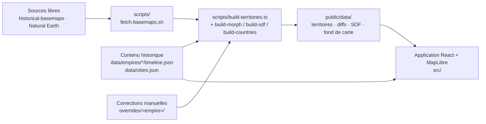

# Atlas des Empires : architecture et techniques

Ce document explique **comment le projet est construit, et pourquoi**, étape par étape. Il s'adresse à quelqu'un qui veut comprendre les techniques utilisées, pas seulement lancer l'application.

---

## 1. Vue d'ensemble

L'application est un **site statique**, sans serveur applicatif. Tout le travail lourd (géométrie, distances, simplification) est fait **à l'avance**, sur la machine de développement, par des scripts. Le navigateur se contente de charger des fichiers prêts à l'emploi et de les animer.



| Couche | Rôle | Où |
|---|---|---|
| Contenu | Récits, dates, armées, personnages, villes | `data/` (JSON écrits par les agents historiens) |
| Pipeline géo | Fabrique les frontières de chaque étape et les données d'animation | `scripts/`, `overrides/` |
| Données servies | Fichiers légers lus par le navigateur | `public/data/` |
| Application | Carte, frise, lecteur, panneaux, animations | `src/` |
| Contrat | Les types partagés par tout le monde | `src/types.ts` |

**Le contrat (`src/types.ts`) est la pièce centrale** : historiens, cartographes et développeurs travaillent en parallèle parce qu'ils s'accordent d'abord sur la forme des données (`Empire`, `TimelineStep`, `ArmyMove`, `Figure`, `City`, etc.).

---

## 2. Le contenu historique (`data/`)

Chaque empire est un dossier `data/empires/<id>/timeline.json` qui contient :

- les métadonnées (nom, couleur, bornes, vue initiale) ;
- une liste d'**étapes**. Une étape a une date, un titre, un type (bataille, traité…), un lieu, un récit en markdown, des conséquences, des sources, ainsi que des champs facultatifs :
  - `battle` : la fiche de bataille ;
  - `armies` : les armées qui marchent, avec trajet, peuple et vainqueur ;
  - `figures` : les personnages, avec leur citation ;
  - `territoryNote` : une phrase précise qui dit ce que l'empire contrôle à cette date. C'est la **spécification** que suit le cartographe.

`data/empires/<id>/regions.json` explique chaque **région** (entité nommée d'un territoire : royaume vassal, part de la Tétrarchie, dynastie rivale…) en 2-3 phrases ; `scripts/list-regions.ts <id>` en donne la liste et recopie les années (`--sync`).

`data/cities.json` liste les villes avec leurs **noms successifs** (Byzance, puis Constantinople), leurs dates de fondation et de destruction, et leur rang. Ce rang décide du niveau de zoom à partir duquel une ville s'affiche.

Ajouter un empire = ajouter un dossier. Le code le détecte automatiquement (`import.meta.glob`).

---

## 3. Le pipeline géographique (`scripts/`)

### 3.1 Sources
- **historical-basemaps** (A. Ourednik, GPL-3.0) : des cartes du monde à différentes années (−500, −323, …, 1800, 1815…), sous forme de polygones nommés.
- **Natural Earth** (domaine public) : les terres, pour des côtes propres, et les pays actuels, pour le calque « Pays 2026 ».

### 3.2 Fabrication d'une étape
Pour chaque étape, `build-territories.ts` suit ces étapes :
1. Il choisit l'**instantané** historique le plus pertinent (le plus proche, de préférence antérieur).
2. Il **filtre** les entités de l'empire (par exemple « Roman Empire », « Byzantine Empire »).
3. Il applique les **overrides** : des polygones dessinés à la main avec une opération `add`, `subtract` ou `replace`. Ils corrigent les dates que les instantanés ne couvrent pas, comme Cannes ou l'apogée sous Trajan. Pour Napoléon, les étapes sont **composées** à partir de régions nommées (Piémont, rive gauche du Rhin, Illyrie…) et des pays Natural Earth.
4. Il **découpe sur les terres** (les polygones historiques débordent en mer).
5. Il **simplifie** la géométrie (algorithme de Douglas-Peucker via turf, tolérance d'environ 0,02°) et arrondit les coordonnées à 3 décimales. Les fichiers passent ainsi de plusieurs Mo à 10-50 Ko.
6. Il **valide** : un fichier vide, une géométrie invalide ou une surface nulle font échouer le build.

Chaque entité garde ses propriétés : `name` (« Royaume d'Italie »), `status` (`core`, `vassal` ou `allied`) et `sourceYear`.

### 3.3 Contrôles qualité automatiques
- **Tableau des surfaces** : pour chaque étape, la surface et sa variation. Un saut de plus de 60 % est signalé pour vérification.
- **Contrôle par points** : on teste si des villes témoins (Paris, Turin, Varsovie…) sont dans le bon territoire, avec le bon statut, à la bonne date (`booleanPointInPolygon`). C'est ainsi qu'on a trouvé, par exemple, que Constantinople manquait : la côte de Natural Earth place la péninsule historique en mer.

### 3.4 Données d'animation précalculées
- `diffs/` : les zones gagnées et perdues entre deux étapes (différence booléenne de polygones).
- `sdf/` : les **champs de distance**, détaillés en section 4.
- `morph/` : les bandes de distance, l'ancienne méthode, gardée comme solution de repli.

Le principe directeur : **tout calcul géométrique coûteux est fait une fois, au build, jamais dans le navigateur.**

---

## 4. L'animation de frontière : trois essais, une solution

C'est la partie la plus technique, et elle illustre bien la démarche par itérations.

### Essai 1 : le fondu enchaîné
L'ancien territoire disparaît en fondu pendant que le nouveau apparaît. C'est simple, mais rien ne « bouge » : on voit deux images se superposer.

### Essai 2 : les bandes
On découpe les zones gagnées en 24 bandes selon leur distance à l'ancienne frontière, et on les allume une par une.
- **Premier problème** : on changeait une expression de style dépendante des données (`['get','t'] <= p`) à chaque image. Pour MapLibre, cela oblige à **recalculer toute la couche dans un worker**. Les mises à jour se télescopaient et seul l'état final apparaissait.
- **Correction** : le `feature-state`, qui allume une bande sans recalcul.
- **Limite restante** : 24 paliers restent 24 paliers, l'œil voit les sauts.

### Essai 3 : les champs de distance (SDF) et un shader. C'est la solution actuelle.
Un **SDF** (*Signed Distance Field*) est une image où chaque pixel ne contient pas une couleur, mais une **distance** : « à quelle distance suis-je de la frontière ? », positive dedans et négative dehors. C'est la technique utilisée par les jeux vidéo pour afficher du texte net à toutes les tailles.

Pour chaque transition, le script `build-sdf.ts` produit une petite image PNG dont les canaux sont :

| Canal | Contenu |
|---|---|
| R | distance signée à la **nouvelle** frontière (128 = sur la frontière) |
| G | distance signée à l'**ancienne** frontière |
| B | « temps d'arrivée » : pour un pixel gagné, sa distance à l'ancien territoire, normalisée entre 0 et 1 ; pour un pixel perdu, 1 moins sa distance au nouveau territoire (les bords extérieurs reculent en premier) |

```
 ancienne frontière         nouvelle frontière
 ██████████|·····→·····→·····|
           t=0   t=0,5     t=1        un pixel devient visible quand p ≥ t
```

Dans le navigateur, un **shader WebGL**, un petit programme exécuté par la carte graphique pour chaque pixel, reçoit **un seul nombre** `p` qui va de 0 à 1 en 3 secondes. Pour chaque pixel, il calcule :

```
visible = (dedans avant ET dedans après)            // partie stable
        + (dedans après ET pas avant) × [p ≥ t]       // ce qui est gagné
        + (dedans avant ET pas après) × [p < t]       // ce qui est perdu
```

Comme `p` est continu, le front avance **pixel par pixel**, à 60 images par seconde, pour presque rien (un seul nombre envoyé au GPU par image). L'interpolation bilinéaire du SDF garde des bords lisses même avec une image de basse résolution, d'environ 0,08° par pixel.

Quelques subtilités :
- **Projection** : la grille est en **Web Mercator**, comme la carte, sinon le raster ne serait pas aligné.
- **Pas d'alpha** : le PNG est en RGB pur. Le navigateur « prémultiplie » l'alpha au décodage, ce qui corromprait les distances.
- **Affichage** : le shader tourne dans le contexte WebGL de MapLibre, comme une **couche personnalisée** (`type: 'custom'`). Sur carte plate, `render` dessine un quad sur l'emprise du SDF. En relief 3D, MapLibre 6 appelle `renderToTerrainTile` pour **draper** la couche sur le terrain avec les autres ; à chaque image, la couche incrémente `terrainTileRevision`, sinon MapLibre réutiliserait ses tuiles drapées en cache.
- **Pourquoi pas une source `canvas`** (première version) : le canvas hors écran était recopié vers MapLibre à chaque image (jusqu'à 1 736 × 1 306 px pour la Chine), et surtout, en relief, une mise à jour du canvas **ne redrapait pas** les tuiles du terrain : le front ne se rafraîchissait que quand autre chose (caméra, chargement de tuiles) forçait un redrapage, tuile par tuile. D'où des saccades pendant le glissement, relief activé (le réglage par défaut).
- **Après la caméra** : le glissement attend la fin du vol de caméra (2 s, divisées par la vitesse au-delà de ×1), pour ne pas partager ses images avec le vol et le chargement des tuiles de relief.
- **Fin d'animation** : à la fin, on bascule en fondu de 250 ms vers les polygones vectoriels, qui sont nets à tous les zooms et distinguent les vassaux.

---

## 5. La carte (`src/map/`)

- **MapLibre GL JS** : moteur de carte WebGL, open source, sans clé d'API. Le style est défini dans le code (`basemapStyle.ts`) et utilise uniquement des données locales, sauf le relief.
- **Vue inclinée et relief** : projection Mercator avec un `pitch` de 50°. Le relief 3D vient des tuiles d'altitude publiques **Terrarium** (AWS), où l'altitude est encodée dans les couleurs RGB des PNG. La couche `hillshade` ombre le relief aux tons parchemin.
- **Ordre des couches** : océan → terres → relief ombré → glissement SDF → territoires → zones gagnées et perdues → pays 2026 → trajets d'armées → villes → marqueurs.
- **Polices** : les libellés WebGL demandent des « glyphes » PBF. Ils sont **téléchargés dans `public/fonts/`** pour fonctionner hors ligne.

### Régions survolables
Survol d'une région = voile clair et contour épais ; clic = fiche (`regionCard.ts` : statut, années, texte de `regions.json`, villes de l'époque contenues dans la région). Actif seulement à l'arrêt (ni lecture, ni glissement, ni question « Devine la suite »).
- Le fondu entre les deux emplacements de territoire repose sur des transitions d'opacité **constantes** : on ne peut pas y mettre une expression `feature-state` (MapLibre n'anime pas les propriétés data-driven). La surbrillance est donc une **petite source à part** (`territory-hover`), qui ne reçoit qu'un `setData` quand la souris change de région, jamais à chaque image.
- Les sources de territoire ont `generateId: true` : l'id rendu = rang de l'entité, ce qui permet de retrouver la **géométrie complète** (celle de `queryRenderedFeatures` est découpée par les tuiles).
- Un clic sur une icône posée au-dessus (monument, invention, route, épidémie) garde la priorité.

### Règles de performance appliquées
1. **Jamais de `setData` ni d'expression data-driven modifiée à chaque image** : cela déclenche un recalcul dans un worker. On utilise à la place le `feature-state`, les transitions natives (`*-transition`) ou un uniform de shader.
2. **Pas d'état React mis à jour à chaque image** : les animations sont pilotées en code impératif (`requestAnimationFrame`) et en CSS (`transform`, `opacity`).
3. **Précalcul** : les diffs, SDF et simplifications sont faits au build.
4. **Fond de carte recadré** : 694 Ko → 105 Ko. **Résolution plafonnée** : `pixelRatio ≤ 2`. **Relief limité** à `maxzoom` 10.

5. **Une seule boucle par animation**, et rien à recopier par image : le glissement ne change qu'un uniform (`p`) par image ; en relief, il redemande explicitement le drapage (`terrainTileRevision`).

Une leçon apprise : le panneau navigateur intégré à l'outil de développement limite l'affichage à environ 1 image par seconde quand il n'a pas le focus. **La fluidité se mesure dans un vrai navigateur.** On peut ajouter `?debug=1` à l'URL pour afficher le compteur d'images par seconde ; pendant un glissement, l'overlay indique aussi la pire image (ms) et le nombre d'images lentes (> 25 ms).

---

## 6. Armées et personnages

- **Figurines** : dessins SVG plats générés par code (`src/figures/`), 24 peuples et 16 types de personnages. Un « constructeur commun » assemble tunique, coiffe, bouclier et arme à partir d'une fiche par peuple. TypeScript impose qu'aucun peuple ne soit oublié (`satisfies Record<Faction, …>`).
- **Marche** : chaque armée suit son `path`, interpolé selon la distance réelle (formule de haversine). Une seule boucle d'animation déplace toutes les figurines. L'alternance des jambes se fait en CSS, sans JavaScript.
- **Chronologie d'une bataille** : marche, puis choc ⚔, puis retrait du vaincu. Les étiquettes « camp · peuple » suivent les armées.
- **Continuité** : une armée qui a un `id` (par exemple `grande-armee`) repart du champ de bataille précédent quand on enchaîne les étapes.
- **Personnages** : une carte (figurine, nom, bulle de citation) reliée à son lieu par un trait. Son placement est recalculé à chaque mouvement de carte par un **algorithme glouton** : on essaie 8 positions autour du lieu et on garde la première qui ne chevauche ni une autre carte, ni les armées, ni les panneaux.

---

## 7. Mode Histoire

- **Web Speech API** (`speechSynthesis`) : la voix de synthèse du navigateur, gratuite et sans serveur. On choisit la meilleure voix française disponible.
- **Script lu** (`src/story/script.ts`) : la date en toutes lettres (convertisseur de nombres maison, « quatre-vingt-onze »), le titre, le résumé, le récit débarrassé du markdown, une conséquence, puis les citations, lues avec une seconde voix si possible.
- **Découpage** : le texte est découpé en phrases, car Chrome coupe les énoncés de plus de 15 s environ. Chaque phrase est surlignée pendant sa lecture.
- **Enchaînement** : c'est la fin de la narration qui fait passer à l'étape suivante, pas un minuteur.

---

## 8. Organisation du travail en agents

Le projet est construit par une équipe d'agents IA coordonnés par un orchestrateur.

| Rôle | Modèle | Responsabilité |
|---|---|---|
| Orchestrateur | Opus | Comprendre la demande, diagnostiquer, fixer le contrat, découper, relire, intégrer, commiter |
| Historien | Sonnet | Contenu : récits, sources, armées, personnages, villes |
| Cartographe | Sonnet | Pipeline géographique, frontières, données d'animation |
| Illustrateur | Sonnet | Figurines SVG |
| Développeur front | Sonnet | Application React/MapLibre |
| QA | Sonnet | Relecture, vérification des liens, contrôle par points |

**Principes :**
1. **Le contrat d'abord** : on écrit les types avant de lancer des agents en parallèle.
2. **Périmètres disjoints** : chaque agent a ses dossiers, pour éviter que deux agents écrivent le même fichier.
3. **Livrables vérifiables** : chaque agent finit par un contrôle automatique (typecheck, build, tableau de surfaces, contrôle par points).
4. **L'orchestrateur relit et vérifie lui-même** les points critiques. Exemple : un rapport signalait des PNG corrompus. Après vérification, la cause était un paramètre d'encodage, que j'ai corrigé directement.
5. **Un commit par livraison**, poussé sur GitHub.

### Stratégie d'économie de tokens
Le coût d'un agent vient surtout de ce qu'il **relit et redécouvre**, beaucoup plus que du code qu'il écrit. D'où les règles suivantes :

1. **Moins d'agents, mieux découpés** : un agent par zone de fichiers cohérente, plutôt qu'un agent par idée.
2. **Diagnostic fourni par l'orchestrateur** : l'agent reçoit la cause, les fichiers, les fonctions et le contrat. Il n'explore pas.
3. **Opus pour réfléchir, Sonnet pour exécuter** : Sonnet est nettement moins cher par token.
4. **Interdits explicites** :
   - pas de tests dans le panneau navigateur, qui est bridé ;
   - pas de lecture intégrale des gros JSON : on utilise de petits scripts `node -e` ;
   - on ne relance que le build de l'empire concerné ;
   - rapports courts.
5. **Reprendre plutôt que recréer** : un agent interrompu est relancé avec son contexte (`SendMessage`).
6. **Petites corrections en direct** : si c'est plus court que d'écrire un prompt, l'orchestrateur corrige lui-même.
7. **L'orchestrateur ne lit que les rapports**, jamais les transcriptions complètes des agents.

---

## 9. Ajouter un empire

1. **Contenu** : créer `data/empires/<id>/timeline.json` (structure : voir `src/types.ts` et l'exemple de Rome), avec un `territoryNote` précis par étape.
2. **Villes** : compléter `data/cities.json`. Les lieux de bataille reçoivent `empires: ["<id>"]`.
3. **Frontières** :
   - créer `scripts/empires/<id>.ts` (étapes, entités à filtrer ou régions à composer) ;
   - placer les corrections dans `overrides/<id>/` ;
   - lancer `npm run build:data -- --empire <id>`.
4. **Régions** : `npx tsx scripts/list-regions.ts <id>`, rédiger `data/empires/<id>/regions.json`, puis `--sync` pour les années.
5. **Figurines** : ajouter les nouveaux peuples et types de personnages dans `src/types.ts`. TypeScript signale alors les dessins manquants dans `src/figures/`.
6. **Vérification** :
   - contrôle par points des villes témoins ;
   - `npm run typecheck && npm run build` ;
   - test dans un vrai navigateur avec `?debug=1`.

---

## 10. Plusieurs empires, catalogue et périodes

- **Catalogue** (`data/empires-catalog.json`) : pour chaque continent, les 3 plus vastes empires de l'histoire et les plus célèbres. Le sélecteur les groupe par continent. Les empires qui ont un dossier `data/empires/<id>/` sont cliquables ; les autres sont grisés avec leurs dates.
- **Bornes par empire** : `Empire.view` donne la vue initiale et `Empire.bounds` le cadre des voisins dessinés (au build). La caméra n'est jamais bornée : chaque empire peut aller voir les autres empires de la même période. Le fond de carte couvre l'Europe, l'Afrique et l'Asie ([-25, -40, 150, 72]).
- **Périodes** (`Empire.periods`) : les « chapitres » d'un long empire, comme les 7 grandes périodes de la Chine. Elles sont dessinées en bandes colorées sous la frise ; un clic saute au début d'une période. Une étape appartient à la dernière période dont le début précède ou égale son année. En mode Histoire, le chapitre est présenté au moment où il commence.
- **Composer plutôt qu'extraire** : pour Napoléon et la Chine, les instantanés historiques sont trop grossiers. Par exemple, une seule entité « Han » couvre toute la Chine, sans distinguer Wei, Shu et Wu. Les étapes sont donc **composées** à partir de pays actuels (Natural Earth) découpés par des **régions nommées** dessinées à la main (`overrides/<empire>/_regions.geojson` : « ligne Qinling-Huai », « bloc de Shu », « rive gauche du Rhin »…). Le code qui assemble chaque étape se trouve dans `scripts/empires/<empire>.ts` et suit la `territoryNote` de chaque étape. Les **contrôles par points** vérifient le résultat ville par ville (150 pour la Chine).
- **Statuts** : `core` pour l'empire lui-même et, en période de division, pour chacun des royaumes rivaux, qui forment ensemble « la Chine » du moment ; `vassal` pour les tributaires et les protectorats ; `allied` pour les alliés contraints, qui ne sont qu'un contour et sont exclus des animations.

### Empires contemporains

Quand on regarde l'empire E à l'étape S (année Y), la carte montre aussi les autres empires de l'Atlas qui existaient en Y (Rome 117 : la Chine Han). `scripts/build-contemporaries.ts` (dernier maillon de `build:data*`, toujours pour tous les empires) écrit `public/data/empires/<E>/contemporaries/<S>.geojson` : pour chaque autre empire F avec `start <= Y <= end`, entités `core`/`vassal` de sa dernière étape d'année <= Y (`lastStepAtOrBefore`, `src/lib/contemporaries.ts`), privées de l'emprise de E (union tamponnée de 30 km pour absorber les liserés), parties < 5000 km² supprimées (< 30 000 km² si l'entité est largement recouverte par E), simplifiées. Un nouvel empire apparaît donc chez les autres, et les leurs chez lui, sans travail à la main (relancer `build:contemporaries`).

Côté front : `loadContemporaries` (cache, vide si absent), `ContemporaryLayers` (`src/map/contemporaryLayers.ts`, sous les territoires ; fondu à chaque étape ; clic = popup avec « Voir cet empire », qui émet l'événement `atlas:goto` écouté par `App`), réglage « Empires contemporains » (`atlas.contemporaries`), section de légende. Les noms de voisins recouverts par un contemporain sont masqués (`dropCoveredLabels`).

## 11. Organisation : parallèle ou en série ?

Le coût d'un agent vient surtout de son **démarrage à froid** : il relit le contexte. Deux agents qui tournent **en même temps** ne coûtent pas plus que deux agents qui tournent **l'un après l'autre**. C'est le **nombre** d'agents qui compte. La règle appliquée :

- **regrouper** dans un même agent les tâches qui partagent beaucoup de contexte ;
- **enchaîner** les tâches qui dépendent l'une de l'autre (le cartographe a besoin des notes territoriales de l'historien) ;
- **paralléliser** les tâches indépendantes qui touchent des fichiers différents, par exemple le contenu d'un empire pendant que la carte d'un autre est dessinée : c'est aussi cher, mais deux fois plus rapide.

## 12. Référencement (SEO)

L'Atlas est une application d'une seule page, rendue en JavaScript : sans précaution, un moteur de recherche n'y verrait qu'un `<div>` vide. Trois mesures rendent visible chaque contenu :

- **Une adresse par contenu** : `/rome/`, `/rome/cannes-216/`, `/chine/`, `/monuments/`… `src/lib/seo.ts` (module pur, partagé par l'application et les scripts) fabrique les chemins, titres (≈ 60-70 caractères) et descriptions (≤ 155). `src/player/urlState.ts` lit le chemin (ou l'ancien `?empire=&step=`) et réécrit l'adresse, le titre, la description et le canonical à chaque étape.
- **Pré-rendu au build** (`scripts/prerender.ts`, après `vite build`) : 262 copies de `index.html` (accueil, 8 empires, 249 étapes, 4 synthèses), chacune avec sa tête (canonical absolu, Open Graph, Twitter Card, JSON-LD `Article`/`BreadcrumbList`/`CollectionPage`/`WebApplication`) et, dans `<div id="root">`, l'article complet (récit, conséquences, sources, liens vers les étapes voisines). React remplace cet article par la carte au démarrage : c'est le même contenu, pas du texte caché. Le script écrit aussi `sitemap.xml`, `robots.txt`, `llms.txt` (résumé pour les assistants IA) et `404.html` (`noindex`). L'adresse publique vient de `actions/configure-pages` (`SITE_URL`) : passer à un nom de domaine ne demande aucun changement de code.
- **Aperçus et performances** : une image de partage par empire (`npm run build:og` : silhouette de l'apogée, emblème, dates, rendue par Chromium), favicon et manifest ; polices hébergées avec le site (`@fontsource`, `font-display: swap`, sous-ensembles par `unicode-range`) au lieu de Google Fonts, qui bloquait le rendu.

Sur GitHub Pages (sous-adresse `/empires-map/`), `robots.txt` n'est pas lu par les moteurs : le sitemap se déclare dans Google Search Console.

## 13. Tests

- **Unitaires** (`tests/unit`, `npm test`, Vitest, environnement node) : fonctions pures de `src/` (formatage des années sans année 0, nombres en lettres pour la narration, périodes et bornes qui se touchent, chaînage des armées, échelle de la frise monotone, palette des entités, emprises géométriques).
- **Données** (`tests/data`, `npm run test:data`) : pour chaque `data/empires/*/timeline.json`, vérifie le contrat de `src/types.ts` (ids uniques, étapes triées dans [start, end], factions et archétypes connus, citations ≤ 120 caractères, chaînage des armées, périodes couvrantes) et la présence des fichiers générés dans `public/data/` (territoires valides, diffs, SDF PNG RGB 8 bits + JSON, voisins) pour chaque transition. Vérifie aussi `cities.json` et le catalogue. Un nouvel empire est testé automatiquement dès que son dossier existe ; les messages d'erreur citent empire, étape et fichier.
- **E2E** (`e2e/`, `npm run test:e2e`, Playwright + Chromium, WebGL logiciel SwiftShader) : construit le site, le sert avec `vite preview` (port 4173) puis joue les parcours clés : chargement sans erreur console, navigation entre étapes, sélecteur d'empire, galerie des figurines (régression StrictMode), zoom depuis la légende, mode Histoire en lecture silencieuse.
- **CI** (`.github/workflows/ci.yml`) : typecheck, unitaires, données, build, e2e ; le rapport Playwright (traces, captures) est publié en artefact en cas d'échec.
- Ces tests protègent surtout contre les données régénérées incomplètes (un `build:data` qui oublie un SDF casserait le glissement) et contre les régressions d'interface qu'un typecheck ne voit pas.
